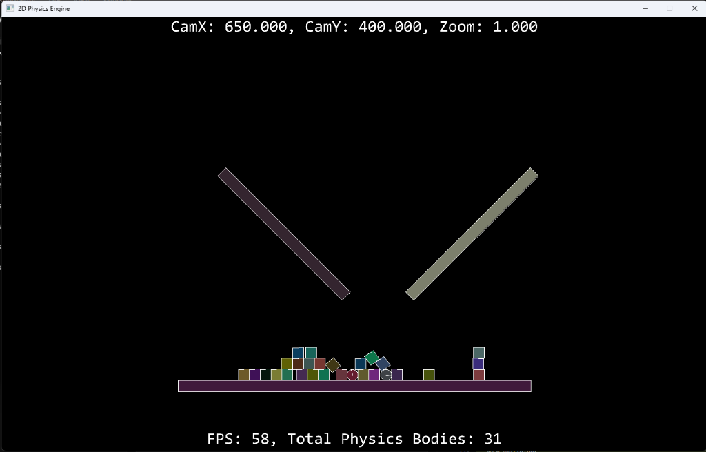

# 2D Physics Engine

A lightweight, high-performance 2D physics engine built from scratch in C++20, SDL2, and modern OpenGL. Designed with a data-oriented, single-compilation-unit (*Handmade Hero* style unity build) philosophy, the engine emphasizes custom mathematics, linear memory arena allocation, continuous rigid body dynamics, and zero external runtime bloat.

<p align="center">
  
</p>

---

## Table of Contents

- [Architectural Overview](#architectural-overview)
- [Core Engine Subsystems](#core-engine-subsystems)
  - [Memory Management (Arenas)](#memory-management-arenas)
  - [Math & Linear Algebra](#math--linear-algebra)
  - [2D Rigid Body Physics](#2d-rigid-body-physics)
  - [Collision Pipeline (Broadphase & SAT Narrowphase)](#collision-pipeline-broadphase--sat-narrowphase)
  - [Camera & Viewport](#camera--viewport)
  - [Rendering Pipeline (OpenGL & SDL2)](#rendering-pipeline-opengl--sdl2)
  - [Input & Controls](#input--controls)
  - [Timing & Performance Profiling](#timing--performance-profiling)
- [Unit Testing Framework](#unit-testing-framework)
  - [Test Architecture](#test-architecture)
  - [Detailed Test Modules](#detailed-test-modules)
  - [Test Execution & Summary Output](#test-execution--summary-output)
- [Build Pipeline & Debugger Generation](#build-pipeline--debugger-generation)
  - [Windows Build Pipeline (MSVC & RAD Debugger)](#windows-build-pipeline-msvc--rad-debugger)
  - [Linux Build Pipeline & Automatic Debugger File Generation](#linux-build-pipeline--automatic-debugger-file-generation)
  - [Step-by-Step Build Instructions](#step-by-step-build-instructions)
- [Interactive Controls](#interactive-controls)
- [Development Tools](#development-tools)

---

## Architectural Overview

The engine is engineered around performance, simplicity, and mechanical transparency:

- **Unity Compilation (Single Translation Unit)**: The entire engine compiles through `game.cpp` as a single compilation unit, eliminating link-time overhead and enabling aggressive compiler inlining and optimizations.
- **Strict Compilation Standards**: Compiles cleanly with `-W4 -WX` on MSVC and `-Wall -Wextra -Werror` on GCC/Clang with C++20 standards.
- **Custom Memory Arenas**: Avoids dynamic runtime allocations (`malloc`, `free`, `new`, `delete`) inside simulation loops; all physics entities, contact pairs, manifolds, and temporary buffers reside in pre-allocated linear memory arenas.

---

## Core Engine Subsystems

### Memory Management (Arenas)
*Files: `code/memory.h`, `code/memory.cpp`*

- **Linear Memory Arena (`memory_arena`)**: Pre-allocated contiguous byte buffer that satisfies allocations via monotonic bump-pointer offsets aligned to cache-friendly boundaries (`DEFAULT_ALIGNMENT`).
- **Scoped Temporary Arenas (`temp_memory_arena`)**: Allows temporary allocations (e.g. scratch calculations or per-frame queries) via `TempMemoryArenaBegin` and `TempMemoryArenaEnd`, completely eliminating memory fragmentation and leak potential.
- **Helper Allocation Macros**: `PushStruct`, `PushArray`, `PushSize`, `ZeroStruct`, `ZeroArray`.

### Math & Linear Algebra
*Files: `code/simple_math.h`, `code/transform_2d.h`, `code/transform_2d.cpp`*

- **Scalars**: Custom `Abs`, `RoundReal32ToUint32`, `Floor`, `Equals` (epsilon tolerance $10^{-4}$), `Clamp` (integer and float), and photometric `LinearTosRGB` gamma curve.
- **Trigonometry**: Standard radian-based `Sin` and `Cos` routines, with optional Taylor series polynomial expansion under `OWN_MATH`.
- **Vectors (`vec2`, `vec3`, `vec4`)**:
  - Memory-efficient anonymous unions with `.xyzw`, `.rgba`, and array `.E[]` access.
  - Complete operator overloads (`+`, `-`, `*`, `/`, `*=`, unary `-`).
  - Vector products: 2D dot product (`Dot`), 2D perp-dot cross product (`Cross`), 3D dot (`Inner`), 3D cross (`Cross`), and component-wise Hadamard product (`Hadamard`).
  - Metrics: Euclidean magnitude (`Magnitude`, `Length`), squared length (`LengthSq`, `DistanceSquared`), `Normalize`, safe zero-vector normalization (`NormalizeOrZero`), and linear interpolation (`Lerp`).
- **Matrices (`mat4x4`)**:
  - Row-major affine transformation matrices.
  - `Identity`, `ScalingMat4x4`, `transMat4x4` (column translation).
  - Matrix addition (`+`), scalar multiplication (`*`), matrix-vector multiplication (`M * v`), and matrix-matrix multiplication (`A * B`).
  - Involution transpose (`transpose`), 3D rotations (`rotateZ`, `rotateX`), and perspective projection (`projection`).
- **2D Transforms (`transform2D`)**:
  - Structure caching position $(p_x, p_y)$ alongside pre-evaluated $\cos\theta$ and $\sin\theta$.
  - Affine rotation and translation: $x' = x\cos\theta - y\sin\theta + p_x$, $y' = x\sin\theta + y\cos\theta + p_y$.
- **Color Packing**:
  - `RGBAPack4x8`: Packs floating-point RGBA components into 32-bit unsigned integers `(A<<24 | B<<16 | G<<8 | R)`.
  - `BGRAPack4x8`: Endianness/format-specific packing for swapchains.
  - `RGBAUnpack4x8`: Unpacks 32-bit packed integers into component floats.
- **Random Number Generation**:
  - Hardware-seeded entropy using x86 `_rdseed32_step`.
  - `RandomUnilateral`: Uniform distribution in $[0.0, 1.0]$.
  - `RandomBilateral`: Uniform distribution in $[-1.0, 1.0]$.

### 2D Rigid Body Physics
*Files: `code/physics_body_2d.h`, `code/physics_body_2d.cpp`, `code/physics_2d.h`*

- **Shapes Supported**: Circles (`CIRCLE`) and Oriented OBB / Boxes (`BOX`).
- **Physical Properties**:
  - Position, linear velocity, force accumulator.
  - Orientation angle (radians), angular velocity, torque/inertia accumulator.
  - Mass, inverse mass ($1/M$), moment of inertia ($I$), inverse inertia ($1/I$).
  - Restitution (coefficient of restitution $e \in [0, 1]$), static friction ($\mu_s$), and dynamic friction ($\mu_k$).
- **Physical Safety Bounds**:
  - Body area bounded between $0.0001\text{ m}^2$ and $1000000\text{ m}^2$.
  - Density bounded between $0.5\text{ g/cm}^3$ and $21.4\text{ g/cm}^3$ (wood to platinum).
  - Gravity defaults to Earth's $9.81\text{ m/s}^2$.

### Collision Pipeline (Broadphase & SAT Narrowphase)
*Files: `code/collision_2d.h`, `code/collision_2d.cpp`*

1. **Broadphase**: Fast Axis-Aligned Bounding Box (AABB) intersection check (`IntersectAABBs`) filters out non-colliding entity pairs into a `contact_pair` array.
2. **Narrowphase (SAT)**:
   - **Circle vs. Circle**: Distance checks between centroids with penetration depth and contact normal generation.
   - **Box vs. Box**: **Separating Axis Theorem (SAT)** tests 4 potential separating axes (face normals of both oriented bounding boxes) to find minimum penetration depth.
   - **Circle vs. Box**: Identifies closest point on oriented box edges to the circle center.
3. **Contact Manifold Generation**: Computes contact points (up to 2 contact points for box-box face contacts) and contact normals.
4. **Impulse Resolution with Rotation & Friction**:
   - Resolves normal impulse $j$ taking into account linear inertia and angular moment of inertia:
     $$j = \frac{-(1 + e)(v_{\text{rel}} \cdot n)}{M_A^{-1} + M_B^{-1} + \frac{(r_A \times n)^2}{I_A} + \frac{(r_B \times n)^2}{I_B}}$$
   - Resolves Coulomb friction impulses (clamping friction impulses to $\le j \cdot \mu_s$).

### Camera & Viewport
*Files: `code/camera.h`, `code/camera.cpp`*

- Pan and zoom support with configurable `MinZoom` and `MaxZoom`.
- Screen-to-world and world-to-screen coordinate transformations (`GetRelativeWorldPosition`).
- Frustum visibility culling (`IsVisible`).
- Automatic out-of-bounds entity cleanup (`DeleteOutofReachPhysicsBodies`).

### Rendering Pipeline (OpenGL & SDL2)
*Files: `code/renderer.h`, `code/renderer.cpp`, `code/glad.c`, `assets/shaders/*`*

- Modern hardware-accelerated OpenGL rendering through GLAD loader.
- Custom vertex and fragment shaders (`vertex.glsl`, `fragment.glsl`) with texture mapping.
- Wireframe debugging mode (`glPolygonMode(GL_FRONT_AND_BACK, GL_LINE)`).
- CPU debug drawing fallback routines using SDL2 geometry.

### Input & Controls
*Files: `code/input.h`, `code/input.cpp`*

- SDL event pump processing keyboard and mouse state.
- Smooth camera panning with right-click mouse drag and zoom with the scroll wheel.
- Dynamic runtime spawning of circles and boxes at the mouse pointer.

### Timing & Performance Profiling
*Files: `code/timer.h`, `code/timer.cpp`, `code/performance.h`*

- Delta-time calculation, frame timing, and rolling FPS counter (`GetFPS`).
- Hardware cycle profiling macros (`BEGIN_TIMED_BLOCK`, `END_TIMED_BLOCK`, `TIMED_BLOCK`) using CPU `__rdtsc()` instructions.

---

## Unit Testing Framework

The engine includes a dedicated automated test suite located in `code/all_tests.cpp` and `code/simple_math_tests.cpp`.

### Test Architecture

- **Assertion Macros**:
  - `ASSERT_CONDITION(condition, message)`: Evaluates boolean expressions.
  - `ASSERT_NEAR(a, b, message)`: Compares floating-point values against standard epsilon ($\epsilon = 0.001f$).
  - `ASSERT_NEAR_EPS(a, b, eps, message)`: Compares floating-point values against custom tolerance thresholds.
- **Macro Hygiene & Safety**: Internal assertion variables use unique prefixes (`_macro_diff_`) to prevent variable shadowing collisions.
- **Granular Test Tracking**: The test runner tracks executed, passed, and failed assertions for each test module, as well as overall pass statistics.

### Detailed Test Modules

| Module | What It Tests | Key Scenarios & Edge Cases |
| :--- | :--- | :--- |
| **Scalars** (`test_scalars`) | Fundamental arithmetic, rounding, clamping, sRGB | `Abs`/`absf` with signed zero and extreme numbers; `RoundReal32ToUint32` boundary half-up rounding; `Floor` with negative floats ($-0.1 \to -1$, $-1.5 \to -2$); `Equals` floating-point threshold comparisons; `Clamp` with equal bounds, negative ranges, and invalid bound safety; `LinearTosRGB` piece-wise linear and exponential gamma branches. |
| **Trigonometry** (`test_trigonometry`) | Radian trigonometric functions | Cardinal angles ($0, \pi/6, \pi/4, \pi/3, \pi/2, \pi, 3\pi/2, 2\pi$); odd/even negative angle symmetries ($-\pi/2, -\pi$); periodic wrap-around ($2\pi + \pi/2, 4\pi$); Pythagorean identity ($\sin^2\theta + \cos^2\theta = 1$) across arbitrary angles. |
| **Vectors** (`test_vectors`) | 2D, 3D, and 4D vector algebra | Union component/array aliasing; vector addition, subtraction, unary negation; scalar multiplication and division (`v / s` and `s / v`); dot products (orthogonal, parallel, anti-parallel); 2D and 3D cross products (handedness, anti-commutativity, orthogonality); magnitudes and Euclidean distances; safe normalization (`NormalizeOrZero` on zero vectors); Hadamard product; linear interpolation (`Lerp`). |
| **Matrices** (`test_matrices`) | 4x4 matrix operations & affine transforms | `Identity` diagonal/off-diagonal verification; diagonal scaling (`ScalingMat4x4`); translation columns (`transMat4x4`); matrix addition and scalar multiplication; matrix-vector multiplication with homogeneous coordinates ($w=1$ for positions, $w=0$ for direction vectors); matrix-matrix multiplication composition $(T \cdot S) \cdot v == T \cdot (S \cdot v)$; matrix transpose involution $(M^T)^T == M$; 3D rotations (`rotateZ`, `rotateX`); perspective projection parameters. |
| **Colors** (`test_colors`) | 32-bit color packing & unpacking | `.rgba` and `.xyzw` union aliasing; `RGBAPack4x8` and `RGBAUnpack4x8` round-trip fidelity for primary colors, black, white, and fractional rounding; `BGRAPack4x8` byte-order verification. |
| **Transforms** (`test_transforms`) | 2D rigid-body transformations | `CreateTransform2D` trig caching; affine point transformation $x' = x\cos\theta - y\sin\theta + p_x$, $y' = x\sin\theta + y\cos\theta + p_y$; identity, pure translation, pure rotations ($90^\circ, 180^\circ, 270^\circ, 360^\circ$), and composite transformation. |
| **Random** (`test_random`) | Hardware-seeded random generation | Hardware entropy initialization via `_rdseed32_step`; `RandomUnilateral` range verification $[0.0, 1.0]$ and spread checks; `RandomBilateral` range verification $[-1.0, 1.0]$ across both positive and negative domains. |

### Test Execution & Summary Output

Run the automated tests using `misc\test.bat` (Windows) or `misc/test.sh` (Linux). The suite prints real-time test progress followed by a structured summary:

```
================================================================================
                               TEST RUN SUMMARY                                 
================================================================================
 Suite / Module             Passed     Failed      Total       Pass %
--------------------------------------------------------------------------------
 Scalars                        71          0         71      100.00%
 Trig                           31          0         31      100.00%
 Vectors                       144          0        144      100.00%
 Matrices                      107          0        107      100.00%
 Colors                         23          0         23      100.00%
 Transforms                     24          0         24      100.00%
 Random                        204          0        204      100.00%
--------------------------------------------------------------------------------
 Tests Pass Percentage:                                                 100.00%
 Total Tests:               604 Passed, 0 Failed, 604 Total
 Suites Pass Percentage:                                                100.00%
 Total Suites:              7 Passed, 0 Failed, 7 Total
================================================================================
 RESULT: ALL TESTS PASSED
================================================================================
```

---

## Build Pipeline & Debugger Generation

The build systems on both Windows and Linux are tailored to support rapid iteration, zero external build-tool dependencies (no CMake required), and automated debugger project generation.

### Windows Build Pipeline (MSVC & RAD Debugger)

On Windows, the build is driven by `misc\build.bat` using the MSVC C++ compiler (`cl.exe`):

1. **Compilation Flags**:
   - Target: `-std:c++20 -Od -Gm- -GR- -EHa- -W4 -WX` (C++20, debug optimization off, minimal rebuild off, RTTI off, C++ exceptions off, warnings-as-errors).
   - Suppressed benign warnings: `-wd4201` (nameless unions), `-wd4100` (unused parameters), `-wd4189` (unused variables), `-wd4505` (unreferenced local functions), `-wd4456` (variable shadowing), `-wd4127` (constant conditionals), `-wd4996` (CRT deprecations).
   - Absolute diagnostics paths: `-FC` emits full file paths so editors (such as 4coder) can jump directly to error lines.
2. **Asset & Dependency Staging**:
   - `third_party\dll\*.dll` is automatically copied into the `build/` output directory.
   - `assets\` directory is mirrored into `build\assets\`.
3. **Hot-Reload / Concurrent PDB Generation**:
   - Windows locks `.pdb` files when a debugger is actively attached. To allow compiling a new executable while an existing debug session is running, `build.bat` emits uniquely randomized PDB filenames:
     ```cmd
     set PDB_FILE_NAME=GAME_%RANDOM%.pdb
     cl ... /link ... /PDB:%PDB_FILE_NAME% /OUT:Game.exe
     ```
4. **RAD Debugger Integration**:
   - Launching `misc\debug.bat` starts the [RAD Debugger](https://github.com/EpicGamesExt/rad-debugger) (`raddbg`) configured with the project layout in `misc\game.rdbg`:
     ```cmd
     raddbg --user:.\misc\game.rdbg .\build\Game.exe
     ```

---

### Linux Build Pipeline & Automatic Debugger File Generation

On Linux, `misc/build.sh` not only compiles the game using GCC (`g++`), but also **automatically generates full IDE and debugger project files** on every build so developers can step through code immediately without manual IDE configuration.

#### 1. Compilation & Maximum Debug Symbols (`-g3`)
```bash
g++ "${CXXFLAGS[@]}" "${CODE_PATH}game.cpp" "${LDFLAGS[@]}" -o "build/$EXE_NAME"
```
- Compiles with `-g3`, which instructs GCC to emit **Level 3 DWARF debug symbols**. This includes macro definitions, inlined function frames, and type layouts for GDB.
- Uses `-fno-diagnostics-show-caret` and `-fno-show-column` for seamless editor parsing in 4coder.
- Links POSIX threads (`-lpthread`), dynamic loader (`-ldl`), OpenGL (`-lGL`), and SDL2 (`-lSDL2 -lSDL2_ttf -lSDL2_image`).

#### 2. Automatic Generation of Qt Creator Project Files
After building the executable, `misc/build.sh` programmatically constructs a complete Qt Creator project:

```bash
# Extract project name from 4coder config (fallback to 2d_phyics)
PROJECT_NAME=$(awk -F'"' '/project_name/ {print $2}' project.4coder 2>/dev/null)
PROJECT_NAME="${PROJECT_NAME:-2d_phyics}"

# 1. Project Marker File
touch "${PROJECT_NAME}.creator"

# 2. Dynamic Source Indexing
find "$CODE_PATH" -type f \( -name "*.cpp" -o -name "*.h" -o -name "*.hpp" \) > "${PROJECT_NAME}.files"

# 3. Header Include Search Paths
echo "${CODE_PATH}" > "${PROJECT_NAME}.includes"
echo "${LIBS_PATH}include" >> "${PROJECT_NAME}.includes"

# 4. Clang Code Model Compiler Flags
printf "%s\n" "${CXXFLAGS[@]}" > "${PROJECT_NAME}.cxxflags"

# 5. Bootstrapping User Debugger Settings
mkdir -p .qtcreator
if [ ! -f ".qtcreator/${PROJECT_NAME}.creator.user" ] && [ -f "debug_template.user.backup" ]; then
    cp debug_template.user.backup ".qtcreator/${PROJECT_NAME}.creator.user"
fi
```

- **`${PROJECT_NAME}.creator`**: The master project descriptor file recognized by Qt Creator.
- **`${PROJECT_NAME}.files`**: Scans the `code/` directory on every build, automatically registering all `.cpp`, `.h`, and `.hpp` files in the project tree without manual CMake/Makefile edits.
- **`${PROJECT_NAME}.includes`**: Supplies include paths (`code/` and `third_party/include`) so the IDE's semantic code engine offers instant autocomplete and symbol navigation.
- **`${PROJECT_NAME}.cxxflags`**: Passes the exact compiler flags (`-std=c++20`, `-DENGINE_DEBUG=1`, etc.) to Qt Creator's Clang Code Model.
- **`.qtcreator/${PROJECT_NAME}.creator.user`**: Automatically bootstrapped from `debug_template.user.backup` if missing. This file configures:
  - Debugger executable target (`build/Game`).
  - Working directory (`build/`).
  - GDB debugger settings, launch environment variables, and pre-set breakpoints.

#### 3. One-Click Linux Debugging (`misc/debug.sh`)
Developers can launch the complete GUI debugging session simply by running:
```bash
./misc/debug.sh
```
This script opens Qt Creator (`qtcreator "${PROJECT_NAME}.creator" &`), which immediately loads the pre-configured project, hooks into GDB, and is ready to step through the simulation.

#### 4. VS Code GDB Integration (`.vscode/launch.json`)
For developers using Visual Studio Code on Linux, `.vscode/launch.json` is pre-configured for GDB:
- **`Debug Game`**: Launches `${workspaceFolder}/build/Game` via `/usr/bin/gdb` with `-enable-pretty-printing` and working directory `${workspaceFolder}/build`.
- **`Debug Tests`**: Launches `${workspaceFolder}/build/Tests` via `/usr/bin/gdb` to debug unit test failures.

---

### Step-by-Step Build Instructions

#### Prerequisites

- **Windows**: Visual Studio 2022 / 2026 with C++ Desktop Development tools.
- **Linux**: GCC 11+ or Clang 13+ with C++20 support and `-mrdseed`.
- **Linux Libraries**:
  - Ubuntu/Debian:
    ```bash
    sudo apt-get install libsdl2-dev libsdl2-ttf-dev libsdl2-image-dev libgl1-mesa-dev qtcreator gdb
    ```
  - Fedora/RHEL:
    ```bash
    sudo dnf install SDL2-devel SDL2_ttf-devel SDL2_image-devel mesa-libGL-devel qtcreator gdb
    ```

#### Windows (MSVC)

1. Open the **x64 Native Tools Command Prompt for VS** (or run `misc\shell.bat`).
2. **Build the game**:
   ```cmd
   misc\build.bat
   ```
3. **Run the game**:
   ```cmd
   .\build\Game.exe
   ```
4. **Launch the RAD Debugger**:
   ```cmd
   misc\debug.bat
   ```
5. **Run the unit tests**:
   ```cmd
   misc\test.bat
   ```

#### Linux (GCC / Clang)

1. Open a terminal in the project root.
2. Ensure shell scripts are executable:
   ```bash
   chmod +x misc/*.sh
   ```
3. **Build the game & generate debugger files**:
   ```bash
   ./misc/build.sh
   ```
4. **Run the game**:
   ```bash
   ./build/Game
   ```
5. **Launch Qt Creator with GDB debugger attached**:
   ```bash
   ./misc/debug.sh
   ```
6. **Run the unit tests**:
   ```bash
   ./misc/test.sh
   ```

---

## Interactive Controls

When running `Game.exe` / `Game`, you can interact with the live simulation using the following controls:

| Control | Action |
| :--- | :--- |
| **`C`** | Spawn a dynamic circle physics body at the mouse cursor position. |
| **`B`** | Spawn a dynamic box physics body at the mouse cursor position. |
| **`R`** | Reset scene (clears spawned bodies back to static platforms). |
| **`Space`** | Toggle OpenGL wireframe mode (`GL_LINE` vs `GL_FILL`) and collision highlight. |
| **`Right Mouse Button` + Drag** | Pan the camera viewport across the world. |
| **`Mouse Wheel`** | Zoom the camera viewport in and out. |

---

## Development Tools

- **4coder Editor**: Configured via `project.4coder` for compilation and navigation keybindings (F1: Build, F2: Run, F3: Debug).
- **RAD Debugger (Windows)**: Configured with `misc/game.rdbg` and launched via `misc/debug.bat`.
- **Qt Creator & GDB (Linux)**: Automatically generated project files (`.creator`, `.files`, `.includes`, `.cxxflags`, `.creator.user`) and launched via `misc/debug.sh`.
- **Visual Studio Code**: Pre-configured build and test tasks in `.vscode/tasks.json` and debug launch configurations in `.vscode/launch.json` for both `Game` and `Tests`.
