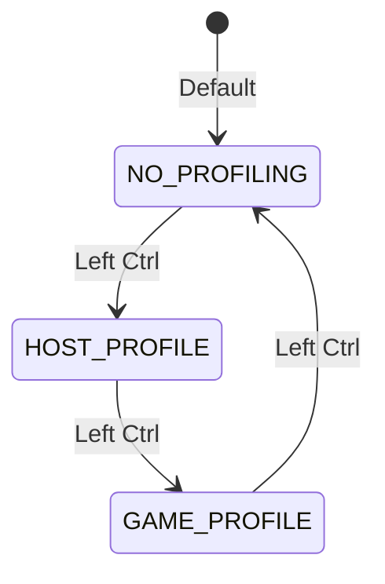

# 2D Physics Engine

A lightweight, high-performance 2D rigid-body physics engine and live-coding environment built from scratch in C++20 and SDL2. 

Designed with a data-oriented, decoupled architecture inspired by *Handmade Hero*, the project features sub-second DLL live code hot-reloading, dual-tier linear memory arena management (Permanent and Transient storage), a hardware-agnostic render command queue, zero frame-time dynamic allocations, and dual-domain compile-time hardware profiling.

<p align="center">
  
</p>

---

## Key Features

- **Live Code Hot-Reloading**: Modify gameplay and simulation logic in [`code/game.cpp`](code/game.cpp), recompile in sub-seconds (`misc\build.bat game`), and witness live state preservation in the running window without restarting the host process.
- **Zero Runtime Allocations**: No `malloc`, `free`, `new`, or `delete` during the simulation loop. Memory is allocated once upfront (256 MB Permanent Storage + 64 MB Transient Storage) and partitioned via linear bump arenas ([`memory_arena`](code/memory.h)).
- **Decoupled Platform Architecture**: Pure simulation logic compiles into a zero-dependency shared library (`game.dll` / `game.so`), interfacing with the platform host (`Game.exe` / `Game`) through a clean, unified C ABI contract in [`code/game_platform.h`](code/game_platform.h).
- **Continuous 2D Rigid Body Dynamics**:
  - **Primitives**: Circles and Oriented Bounding Boxes (OBB) with exact mass and moment of inertia derivations.
  - **Broadphase**: Axis-Aligned Bounding Box (AABB) intersection pruning.
  - **Narrowphase**: **Separating Axis Theorem (SAT)** with contact manifold generation (single-point and edge-incident two-point manifolds).
  - **Impulse Resolution**: Sequential impulses accounting for restitution, linear momentum, angular inertia, and Coulomb friction.
  - **Entity Boundary Culling**: Automatic viewport out-of-reach detection and culling for bodies escaping world bounds.
- **Decoupled Render Command Queue**: Simulation outputs hardware-agnostic draw commands (`PushClear`, `PushQuad`, `PushBox`, `PushCircle`, `PushLine`, `PushText`) into a linear byte buffer consumed by the platform renderer.
- **Dual-Domain Hardware Profiling**: Compile-time cycle profiler (`TIMED_BLOCK`, `TIMED_FUNCTION`) utilizing `__COUNTER__` and `__rdtsc()` for zero-branch, sub-nanosecond telemetry. Supports cycling between **Host/Platform Profiler** (magenta) and **Game/Physics Profiler** (yellow) without symbol collision.
- **Automated Test Suite**: Comprehensive floating-point test harness with **604 tests across 7 modules** covering scalars, trigonometry, 2D/3D vectors, 3x3 matrices, colors, transforms, and random distributions with 100% pass verification.

> [!NOTE]
> For detailed architectural diagrams, memory layouts, hot-reloading internals, and collision mathematics, see **[`TECHNICAL_DETAILS.md`](TECHNICAL_DETAILS.md)**.

---

## Quick Start

### Windows (MSVC)

Prerequisites: Visual Studio 2022/2026 with C++ Desktop development tools.

1. Open the **x64 Native Tools Command Prompt for VS** (or run `misc\shell.bat`).
2. **Build the engine**:
   ```cmd
   misc\build.bat
   ```
3. **Run the engine**:
   ```cmd
   misc\run.bat
   ```
4. **Hot-reload while running**:
   Tweak values in [`code/game.cpp`](code/game.cpp) and recompile only the simulation DLL:
   ```cmd
   misc\build.bat game
   ```
5. **Run test suite**:
   ```cmd
   misc\test.bat
   ```

### Linux (GCC / Clang)

Prerequisites: GCC 11+ or Clang 13+ with C++20 support and SDL2 development libraries.

```bash
# Install dependencies (Debian/Ubuntu)
sudo apt-get install libsdl2-dev libsdl2-ttf-dev libsdl2-image-dev libgl1-mesa-dev

# Build & Run
chmod +x misc/*.sh
./misc/build.sh
./misc/run.sh

# Live recompile game logic while running
./misc/build.sh game

# Run tests
./misc/test.sh
```

---

## Interactive Controls

| Control | Action |
| :--- | :--- |
| **`Left Mouse Button`** or **`C`** | Spawn a dynamic circle at mouse cursor position |
| **`B`** | Spawn a dynamic box (OBB) at mouse cursor position |
| **`R`** | Reset scene (clears dynamic bodies, retains static platforms) |
| **`Space`** | Toggle wireframe rendering mode |
| **`Left Alt`** | Toggle collision contact highlighting (bodies flash red on contact) |
| **`Left Ctrl`** | Cycle profiler modes (`None` &rarr; `Host Profiler` &rarr; `Game Profiler`) |
| **`Right Mouse Button` + Drag** | Pan camera viewport across the world |
| **`Mouse Wheel`** | Zoom camera viewport in and out (clamped to zoom bounds) |
| **`Escape`** | Exit the application |

---

## Profiling Modes

The engine features runtime-switchable compile-time hardware profiling via `Left Ctrl`:



- **Off (`NO_PROFILING`)**: Clean viewport with minimal HUD (FPS, Body count, Zoom level).
- **Host Profiler (`HOST_PROFILE`)**: Visualizes CPU cycle expenditure and hit counts across platform systems in `sdl_main.cpp`. In Pink Color.
- **Game Profiler (`GAME_PROFILE`)**: Visualizes granular cycle consumption across physics sub-stepping, collision narrowphase, and camera transformations in `game.cpp`. In Yellow Color.

---

## Project Structure

```
2d_physics_engine/
├── code/
│   ├── game_platform.h     # Platform contract (game_memory, game_input, render queue)
│   ├── game.h / game.cpp   # Simulation core & state management (compiles to game.dll)
│   ├── sdl_main.cpp        # Platform host, SDL event loop, hot-reload manager (Game.exe)
│   ├── physics_body_2d.h/cpp # Rigid bodies, inertia tensors, shapes, force integration
│   ├── collision_2d.h/cpp  # SAT narrowphase, AABB broadphase, contact manifold generation
│   ├── simple_math.h       # Vector2/3, Matrix3x3, trig, and coordinate transformations
│   ├── transform_2d.h/cpp  # Affine transformations and vertex orientation helpers
│   ├── memory.h / cpp      # Linear bump memory arenas (Permanent & Transient)
│   ├── camera.h / cpp      # Viewport pan, zoom, and world-to-screen projection
│   ├── performance.h       # Zero-branch hardware profiler (__COUNTER__ & __rdtsc)
│   ├── defines.h           # Base types, utility macros, assertions, and logging
│   ├── all_tests.cpp       # Unit test runner entry point
│   └── simple_math_tests.cpp # 604 automated math, vector, matrix, and transform tests
├── misc/
│   ├── build.bat / build.sh# Unified build scripts (Windows MSVC & Linux GCC)
│   ├── run.bat / run.sh    # Executable launchers
│   ├── test.bat / test.sh  # Automated test suite runners
│   ├── debug.bat / debug.sh# RAD Debugger and debugger launchers
│   ├── shell.bat / shell.sh# Development environment setup
│   └── game.rdbg           # RAD Debugger layout configuration
├── assets/                 # Fonts, textures, and shader assets
├── README.md               # Quick overview & getting started guide
└── TECHNICAL_DETAILS.md    # Deep dive into architecture, memory, & math subsystems
```

---

## Automated Test Suite

The engine includes a custom floating-point test framework with zero external dependencies:

```cmd
misc\test.bat
```

```
================================================================================
                               TEST RUN SUMMARY                                 
================================================================================
 Suite / Module             Passed     Failed      Total       Pass %
--------------------------------------------------------------------------------
 Scalars                        71          0         71      100.00%
 Trig                           31          0         31      100.00%
 Vectors                       144          0        144      100.00%
 Matrices                      107          0        107      100.00%
 Colors                         23          0         23      100.00%
 Transforms                     24          0         24      100.00%
 Random                        204          0        204      100.00%
--------------------------------------------------------------------------------
 Tests Pass Percentage:                                                 100.00%
 Total Tests:               604 Passed, 0 Failed, 604 Total
 Suites Pass Percentage:                                                100.00%
 Total Suites:              7 Passed, 0 Failed, 7 Total
================================================================================
 RESULT: ALL TESTS PASSED
================================================================================
```

---

## Deep Dive & Documentation

For a complete breakdown of internal systems, mathematical derivations, and architecture, refer to **[`TECHNICAL_DETAILS.md`](TECHNICAL_DETAILS.md)**:
- **[Decoupled Platform Architecture](TECHNICAL_DETAILS.md#architectural-design--philosophy)** (C ABI boundary & Mermaid sequence diagrams)
- **[Dual-Tier Memory Model](TECHNICAL_DETAILS.md#memory-management-architecture)** (Permanent vs. Transient storage, memory layout)
- **[Live Code Hot-Reloading](TECHNICAL_DETAILS.md#live-code-hot-reloading-pipeline)** (PDB randomization, shadow copying, lock-file synchronization)
- **[Render Command Queue](TECHNICAL_DETAILS.md#render-command-buffer-pipeline)** (Hardware decoupling, command structures)
- **[Hardware Telemetry & Profiler](TECHNICAL_DETAILS.md#telemetry--performance-profiling-subsystem)** (Compile-time `__COUNTER__` indexing, cycle counting, hot-reload publishing)
- **[Physics & Collision Engine](TECHNICAL_DETAILS.md#core-physics--simulation-subsystems)** (SAT derivation, impulse formulas, friction)
- **[Testing & Tooling](TECHNICAL_DETAILS.md#automated-testing-framework)** (Test modules, 4coder, RAD Debugger, Qt Creator)
