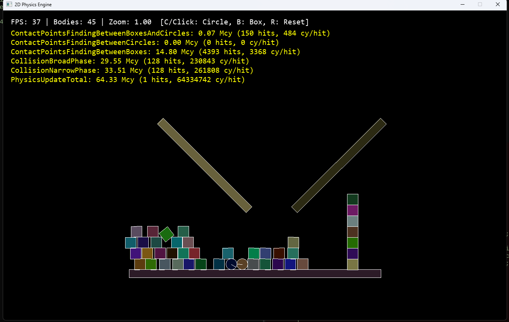

# 2D Physics Engine

A lightweight, high-performance 2D rigid-body physics engine and live-coding environment built from scratch in C++20 and SDL2. 

Designed with a data-oriented, decoupled architecture inspired by *Handmade Hero*, the project features instant DLL live code editing, dual-tier linear memory management (Permanent and Transient storage), a decoupled render command queue, and zero frame-time dynamic allocations.

<p align="center">
  
</p>

---

## Key Features

- **Live Code Hot-Reloading**: Modify gameplay and simulation code in [`code/game.cpp`](code/game.cpp), recompile in sub-seconds, and see changes update live in the running window without losing entity state.
- **Zero Runtime Allocations**: No `malloc`, `free`, `new`, or `delete` during the simulation loop. Memory is pre-allocated upfront (256 MB Permanent Storage + 64 MB Transient Storage) and managed via linear bump arenas.
- **Decoupled Platform Architecture**: Pure physics/game simulation compiles into a zero-dependency shared library (`game.dll` / `game.so`), completely isolated from the platform host (`Game.exe`).
- **Continuous 2D Rigid Body Dynamics**:
  - Primitives: Circles and Oriented Bounding Boxes (OBB).
  - Broadphase: AABB pruning.
  - Narrowphase: **Separating Axis Theorem (SAT)** with contact manifold generation.
  - Sequential impulse resolution supporting restitution, angular inertia, and Coulomb friction.
- **Decoupled Render Command Buffer**: Simulation emits abstract draw packets (`PushClear`, `PushQuad`, `PushCircle`, `PushText`) consumed by the platform backend.
- **Automated Test Suite**: Comprehensive floating-point test suite covering vectors, matrices, transforms, and trigonometry with 100% pass verification.

> [!NOTE]
> For detailed architectural diagrams, memory layouts, hot-reloading internals, and collision mathematics, see **[`TECHNICAL_DETAILS.md`](TECHNICAL_DETAILS.md)**.

---

## Quick Start

### Windows (MSVC)

Prerequisites: Visual Studio 2022/2026 with C++ Desktop tools.

1. Open the **x64 Native Tools Command Prompt for VS** (or run `misc\shell.bat`).
2. **Build the engine**:
   ```cmd
   misc\build.bat
   ```
3. **Run the engine**:
   ```cmd
   misc\run.bat
   ```
4. **Hot-reload while running**:
   Tweak values in [`code/game.cpp`](code/game.cpp) and recompile the DLL without restarting:
   ```cmd
   misc\build.bat game
   ```
5. **Run tests**:
   ```cmd
   misc\test.bat
   ```

### Linux (GCC / Clang)

Prerequisites: GCC 11+ or Clang 13+ with C++20 support and SDL2 development libraries.

```bash
# Install dependencies (Ubuntu/Debian)
sudo apt-get install libsdl2-dev libsdl2-ttf-dev libsdl2-image-dev libgl1-mesa-dev

# Build & Run
chmod +x misc/*.sh
./misc/build.sh
./misc/run.sh

# Run tests
./misc/test.sh
```

---

## Interactive Controls

| Control | Action |
| :--- | :--- |
| **`Left Mouse Button`** or **`C`** | Spawn a dynamic circle at the mouse cursor |
| **`B`** | Spawn a dynamic box at the mouse cursor |
| **`R`** | Reset scene (clears dynamic bodies, retains static platforms) |
| **`Space`** | Toggle collision contact highlighting (bodies flash red on contact) |
| **`Right Mouse Button` + Drag** | Pan the camera viewport across the world |
| **`Mouse Wheel`** | Zoom the camera viewport in and out |
| **`Escape`** | Exit the application |

---

## Project Structure

```
2d_physics_engine/
├── code/
│   ├── game_platform.h     # Platform-agnostic contract (memory, input, render queue)
│   ├── game.h / game.cpp   # Pure simulation core (compiles to game.dll)
│   ├── sdl_main.cpp        # Platform host & hot-reload manager (compiles to Game.exe)
│   ├── physics_body_2d.h   # Rigid body definitions, inertia, and shapes
│   ├── collision_2d.h/cpp  # SAT narrowphase, AABB broadphase, contact manifolds
│   ├── simple_math.h       # Vector, matrix, trig, and coordinate transformations
│   ├── memory.h / cpp      # Linear memory arena bump allocators
│   ├── camera.h / cpp      # Viewport pan, zoom, and world-to-screen projection
│   └── all_tests.cpp       # Automated unit test suite
├── misc/
│   ├── build.bat / build.sh# Build scripts for Windows & Linux
│   ├── run.bat / run.sh    # Executable launchers
│   ├── test.bat / test.sh  # Automated test runners
│   ├── debug.bat / debug.sh# RAD Debugger / Qt Creator launchers
│   └── game.rdbg           # RAD Debugger layout configuration
├── assets/                 # Fonts, textures, and test assets
├── README.md               # Quick overview & getting started guide
└── TECHNICAL_DETAILS.md    # Deep dive into architecture, memory, & subsystems
```

---

## Deep Dive & Documentation

For a complete breakdown of the engine's internal systems, read **[`TECHNICAL_DETAILS.md`](TECHNICAL_DETAILS.md)**:
- **[Decoupled Platform Architecture](TECHNICAL_DETAILS.md#architectural-design--philosophy)** (C ABI boundary & Mermaid sequence diagrams)
- **[Dual-Tier Memory Model](TECHNICAL_DETAILS.md#memory-management-architecture)** (Permanent vs. Transient storage, memory map)
- **[Live Code Hot-Reloading](TECHNICAL_DETAILS.md#live-code-hot-reloading-pipeline)** (PDB randomization, shadow copying, lock-file synchronization)
- **[Render Command Queue](TECHNICAL_DETAILS.md#render-command-buffer-pipeline)** (Hardware decoupling, command structures)
- **[Physics & Collision Engine](TECHNICAL_DETAILS.md#core-physics--simulation-subsystems)** (SAT derivation, impulse formulas)
- **[Testing & Tooling](TECHNICAL_DETAILS.md#automated-testing-framework)** (Test modules, 4coder, RAD Debugger, Qt Creator)
