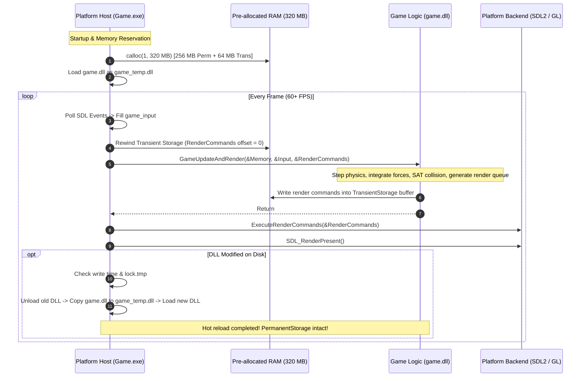
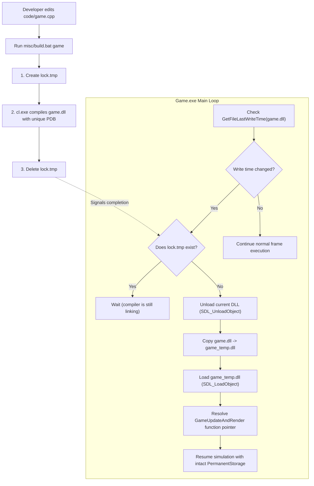

# Technical Architecture & Engine Subsystems

This document provides an in-depth technical analysis of the 2D Physics Engine's architecture, memory layout, live code hot-reloading pipeline, render command buffer, continuous collision detection, and mathematical foundations.

---

## Table of Contents

- [Architectural Design & Philosophy](#architectural-design--philosophy)
  - [Decoupled Platform / Logic Boundary](#decoupled-platform--logic-boundary)
  - [Architecture Flow Diagram](#architecture-flow-diagram)
  - [Zero-Dependency Game Core](#zero-dependency-game-core)
- [Memory Management Architecture](#memory-management-architecture)
  - [Permanent Storage (256 MB)](#permanent-storage-256-mb)
  - [Transient Storage (64 MB)](#transient-storage-64-mb)
  - [Linear Bump Allocation (`memory_arena`)](#linear-bump-allocation-memory_arena)
  - [Visual Memory Map](#visual-memory-map)
- [Live Code Hot-Reloading Pipeline](#live-code-hot-reloading-pipeline)
  - [Hot-Reload Cycle](#hot-reload-cycle)
  - [DLL Shadow Copying (`game_temp.dll`)](#dll-shadow-copying-game_tempdll)
  - [Lock File Synchronization (`lock.tmp`)](#lock-file-synchronization-locktmp)
- [Render Command Buffer Pipeline](#render-command-buffer-pipeline)
  - [Decoupled Command Queue](#decoupled-command-queue)
  - [Command Types & Protocol](#command-types--protocol)
  - [Platform Execution Backend](#platform-execution-backend)
- [Core Physics & Simulation Subsystems](#core-physics--simulation-subsystems)
  - [Math & Linear Algebra](#math--linear-algebra)
  - [2D Rigid Body Physics](#2d-rigid-body-physics)
  - [Collision Pipeline (Broadphase & SAT Narrowphase)](#collision-pipeline-broadphase--sat-narrowphase)
  - [Impulse Resolution & Friction](#impulse-resolution--friction)
  - [Camera & Coordinate Projection](#camera--coordinate-projection)
- [Automated Testing Framework](#automated-testing-framework)
  - [Test Architecture](#test-architecture)
  - [Detailed Test Modules](#detailed-test-modules)
  - [Test Execution & Summary Output](#test-execution--summary-output)
- [Build Pipeline & Tooling Integration](#build-pipeline--tooling-integration)
  - [Windows Build Pipeline (MSVC & 4coder)](#windows-build-pipeline-msvc--4coder)
  - [Linux Build Pipeline & Qt Creator Integration](#linux-build-pipeline--qt-creator-integration)
  - [RAD Debugger Integration](#rad-debugger-integration)

---

## Architectural Design & Philosophy

The engine is engineered around three core principles: **absolute mechanical transparency**, **zero frame-time allocations**, and **instantaneous developer iteration**.

```
+-----------------------------------------------------------------------------------+
|                                 PLATFORM HOST                                     |
|                       (code/sdl_main.cpp -> Game.exe)                             |
|  - Windowing & Event Pump (SDL2)        - Static Memory Allocation (320 MB)       |
|  - Clock & High-Res Timer               - DLL Hot-Reload Manager                  |
|  - Render Command Execution Backend     - Base Path Resolution (SDL_GetBasePath)  |
+-----------------------------------------------------------------------------------+
                                         |
                       Platform Contract (code/game_platform.h)
                     [ game_memory | game_input | game_render_commands ]
                                         |
                                         v
+-----------------------------------------------------------------------------------+
|                                 GAME SIMULATION                                   |
|                         (code/game.cpp -> game.dll)                               |
|  - 2D Rigid Body Dynamics               - Linear Memory Arenas                    |
|  - SAT Collision Detection & Manifolds  - Camera Transformation                   |
|  - Continuous Impulse Resolution        - Render Command Queue Generation         |
+-----------------------------------------------------------------------------------+
```

### Decoupled Platform / Logic Boundary
Rather than compiling the platform layer, renderer, and game logic into a monolithic executable, the project splits strictly into two distinct modules communicating through a pure C ABI ([`code/game_platform.h`](code/game_platform.h)):

1. **Platform Host Executable (`Game.exe` / `Game`)**:
   - Implemented in [`code/sdl_main.cpp`](code/sdl_main.cpp).
   - Responsible for operating system interactions: window creation, input event polling, audio, high-precision timing, DLL loading/unloading, and graphics presentation.
   - Owns the continuous 320 MB memory block in RAM for the entire duration of the process.

2. **Game Simulation Shared Library (`game.dll` / `game.so`)**:
   - Implemented in [`code/game.cpp`](code/game.cpp).
   - Contains pure simulation logic: physics world stepping, rigid body integration, collision resolution, camera tracking, and scene updating.
   - Exposes a single public entry point:
     ```cpp
     GAME_UPDATE_AND_RENDER(GameUpdateAndRender);
     ```

### Architecture Flow Diagram



### Zero-Dependency Game Core
The game library (`game.dll`) does not link against SDL2, Win32, or OpenGL. It compiles as a standalone compilation unit with zero platform headers. All system services (inputs, frame deltas, render buffers, and RAM) are passed in explicitly as pointers by the platform host.

---

## Memory Management Architecture

The engine rejects runtime `malloc`, `free`, `new`, and `delete` in the simulation loop. Instead, the platform host pre-allocates a single contiguous memory block at initialization and slices it into two fixed regions ([`code/sdl_main.cpp`](code/sdl_main.cpp)):

```cpp
uint64 PermanentStorageSize = Megabytes(256);
uint64 TransientStorageSize = Megabytes(64);
uint64 TotalSize = PermanentStorageSize + TransientStorageSize; // 320 MB

void* MemoryBlock = calloc(1, TotalSize);

game_memory Memory = {};
Memory.PermanentStorageSize = PermanentStorageSize;
Memory.PermanentStorage     = MemoryBlock;
Memory.TransientStorageSize = TransientStorageSize;
Memory.TransientStorage     = (uint8*)MemoryBlock + PermanentStorageSize;
Memory.IsInitialized        = false;
```

### Permanent Storage (256 MB)
- **Lifetime**: Entire duration of the application process. Persists across DLL live reloads.
- **Contents**:
  - `game_state` structure sitting at byte 0.
  - Linear `memory_arena` (`WorldArena`) managing rigid bodies (`MAX_BODIES = 4096`), contact pairs (`MAX_CONTACT_PAIRS = 100000`), collision manifolds, and entity color buffers.
- **Initialization Guard**: Initialized only once when `Memory->IsInitialized == false`. When a new DLL is loaded, `Memory->IsInitialized` remains `true`, allowing the new code to seamlessly continue simulating existing entity states without resetting.

### Transient Storage (64 MB)
- **Lifetime**: Exactly one frame.
- **Contents**: Scratchpad memory, per-frame mathematical caches, and the primary **Render Command Buffer** (`game_render_commands`).
- **Reset Frequency**: At the start of every frame, the buffer offset is reset to `0`. Allocations within the frame are effectively free (costing only a pointer addition), and deallocation is a single assignment (`CurrentBufferSize = 0`).

### Linear Bump Allocation (`memory_arena`)
*Files: [`code/memory.h`](code/memory.h), [`code/memory.cpp`](code/memory.cpp)*

All persistent structures are allocated through bump allocators:
- `PushStruct(Arena, type)`: Allocates and zeros a single structure aligned to 16-byte boundaries (`DEFAULT_ALIGNMENT`).
- `PushArray(Arena, Count, type)`: Allocates contiguous arrays.
- `TempMemoryArenaBegin` / `TempMemoryArenaEnd`: Scoped sub-arenas that restore previous allocation watermarks for local scratch tasks.

### Visual Memory Map

```
Total Allocation: 320 MB (One Contiguous calloc in Game.exe Address Space)
+-------------------------------------------------------------------+-----------------------------------+
|                    Permanent Storage (256 MB)                     |      Transient Storage (64 MB)    |
+-------------------+-----------------------------------------------+-----------------------------------+
| struct game_state | WorldArena:                                   | Render Command Buffer (4 MB)      |
| - Camera state    | - Bodies (4,096 * sizeof(physics_body2D))     | - Clear commands                  |
| - BodyColors ptr  | - ContactPairs (100,000 * contact_pair)       | - Quad vertex buffers             |
| - World pointer   | - CollisionManifolds (100,000 * manifold)     | - Circle packets                  |
| - Settings/flags  | - ContactPoints (100,000 * vec2)              | - Text draw requests              |
|                   | - Static platform definitions                 | Scratch space (60 MB)             |
+-------------------+-----------------------------------------------+-----------------------------------+
^                                                                   ^
Memory.PermanentStorage                                             Memory.TransientStorage
```

---

## Live Code Hot-Reloading Pipeline

The architecture supports modifying gameplay and physics code in `code/game.cpp`, recompiling, and seeing the changes take effect in the running application **within milliseconds without restarting the window or losing entity state**.



### Hot-Reload Cycle
1. **Timestamp Polling**: The host calls `GetFileLastWriteTime(SourceDLLPath)` every frame.
2. **Lock File Protection**: Before invoking the compiler, `misc\build.bat` writes `lock.tmp`. The host checks for the presence of `lock.tmp` before attempting to reload, preventing it from reading partially written DLLs.
3. **PDB Randomization**: Windows debuggers lock `.pdb` files during active execution. To prevent MSVC linker collisions (`LNK1104`), `build.bat` generates randomized PDB names per compilation:
   ```cmd
   set DLL_PDB_NAME=game_%RANDOM%.pdb
   cl ... /PDB:%DLL_PDB_NAME% /EXPORT:GameUpdateAndRender /OUT:game.dll
   ```

### DLL Shadow Copying (`game_temp.dll`)
Because Windows places a file-execution lock on any loaded DLL, `Game.exe` never loads `game.dll` directly. Instead:
1. `Game.exe` copies `game.dll` to `game_temp.dll`.
2. It loads `game_temp.dll` via `SDL_LoadObject`.
3. When the developer recompiles, MSVC can freely overwrite `game.dll` on disk without locking errors.

---

## Render Command Buffer Pipeline

Rendering is decoupled from game simulation using the **Render Command Buffer** pattern ([`code/game_platform.h`](code/game_platform.h)):

```
[ game.dll ]
     |
     | PushClear(), PushQuad(), PushCircle(), PushText()
     v
[ game_render_commands Buffer in Transient Storage ]
     |
     | Passed back across the module boundary
     v
[ Game.exe: ExecuteRenderCommands() ]
     |
     | SDL_RenderGeometry(), SDL_RenderDrawLineF(), TTF_RenderText_Blended()
     v
[ Screen Presentation ]
```

### Decoupled Command Queue
`game.dll` has no knowledge of SDL, OpenGL, or Direct3D. It simply appends structured command headers into `RenderCommands.BufferBase`:

```cpp
struct game_render_commands
{
    uint32 Width;
    uint32 Height;
    uint32 MaxBufferSize;
    uint32 CurrentBufferSize;
    uint8* BufferBase;
    uint32 CommandCount;
};
```

### Command Types & Protocol
Every command starts with a `render_command_header` describing its payload:

| Command Type | Data Structure | Purpose |
| :--- | :--- | :--- |
| `RenderCommand_Clear` | `render_command_clear` | Clears viewport to normalized RGBA color |
| `RenderCommand_Quad` | `render_command_quad` | 4 world/screen vertices with fill color, outline color, and border flag |
| `RenderCommand_Circle` | `render_command_circle` | Center point, radius, orientation line, fill, and outline |
| `RenderCommand_Line` | `render_command_line` | Start and end points with color |
| `RenderCommand_Text` | `render_command_text` | Screen position, string buffer, font size, and color |

### Platform Execution Backend
In [`code/sdl_main.cpp`](code/sdl_main.cpp), `ExecuteRenderCommands()` iterates through `Commands->BufferBase` from offset `0` to `CurrentBufferSize`:
- **Quads**: Emitted via `SDL_RenderGeometry` with an indexed triangle list `{0, 1, 3, 1, 2, 3}`, followed by `SDL_RenderDrawLineF` for perimeter outlines.
- **Circles**: Rendered using Bresenham midpoint rasterization algorithms for filled bodies and orientation indicators.
- **Text**: Rendered using SDL_ttf (`TTF_RenderText_Blended`) into textures cached and presented per frame.

---

## Core Physics & Simulation Subsystems

### Math & Linear Algebra
*Files: [`code/simple_math.h`](code/simple_math.h), [`code/transform_2d.h`](code/transform_2d.h), [`code/transform_2d.cpp`](code/transform_2d.cpp)*

- **Vectors (`vec2`, `vec3`, `vec4`)**: Anonymous union components supporting `.xyzw`, `.rgba`, and array indexing `.E[]`. Complete arithmetic operator overloads, dot product (`Dot`), perp-dot product (`Cross`), and safe normalization (`NormalizeOrZero`).
- **2D Affine Transforms (`transform2D`)**: Caches coordinate positions alongside precomputed $\cos\theta$ and $\sin\theta$ for fast trigonometric rotation and translation without redundant transcendental calls.
- **Matrix 4x4 (`mat4x4`)**: Full row-major affine transformations, translations, rotations, perspective projections, and matrix-vector multiplication.
- **Entropy**: Hardware-seeded random number generation using CPU intrinsic `_rdseed32_step` (`RandomUnilateral`, `RandomBilateral`).

### 2D Rigid Body Physics
*Files: [`code/physics_body_2d.h`](code/physics_body_2d.h), [`code/physics_body_2d.cpp`](code/physics_body_2d.cpp), [`code/physics_2d.h`](code/physics_2d.h)*

- **Supported Primitives**: Circles (`CIRCLE`) and Oriented Bounding Boxes (`BOX`).
- **State Representation**: Position, linear velocity, angular orientation (radians), angular velocity, forces, and torque accumulators.
- **Mass & Inertia**: Automatically derives mass, moment of inertia ($I$), inverse mass ($1/M$), and inverse inertia ($1/I$) from shape dimensions and density.
- **Material Tuning**: Configurable restitution (elasticity $e \in [0, 1]$), static friction ($\mu_s$), dynamic friction ($\mu_k$), and static immovable body flags (`IsStatic`).

### Collision Pipeline (Broadphase & SAT Narrowphase)
*Files: [`code/collision_2d.h`](code/collision_2d.h), [`code/collision_2d.cpp`](code/collision_2d.cpp)*

1. **Broadphase**: Fast Axis-Aligned Bounding Box (AABB) overlap testing (`IntersectAABBs`) filters out disjoint entities into candidate `contact_pair` records.
2. **Narrowphase (Separating Axis Theorem)**:
   - **Circle vs. Circle**: Centroid distance tests with penetration depth calculation.
   - **Box vs. Box**: Evaluates 4 candidate normal axes (the face normals of both oriented boxes) using SAT projection intervals to determine minimum penetration depth and collision normals.
   - **Circle vs. Box**: Clamps circle centroid to oriented box bounds to locate the nearest feature point.
3. **Contact Manifold Generation**: Computes contact points (up to 2 points for box edge contacts) and normal vectors.

### Impulse Resolution & Friction
Collisions are resolved through sequential impulse formulation:
- **Normal Impulse**: Calculates restitution impulse $j$ taking into account linear inertia and moment of inertia:
  $$j = \frac{-(1 + e)(v_{\text{rel}} \cdot n)}{M_A^{-1} + M_B^{-1} + \frac{(r_A \times n)^2}{I_A} + \frac{(r_B \times n)^2}{I_B}}$$
- **Friction Impulse**: Tangential Coulomb friction impulses computed and clamped to the friction cone ($\le j \cdot \mu_s$).
- **Sub-stepping**: Integrator runs multiple substeps per frame (default: 128 iterations) for high-speed collision stability and stacking behavior.

### Camera & Coordinate Projection
*Files: [`code/camera.h`](code/camera.h), [`code/camera.cpp`](code/camera.cpp)*

- World-to-screen (`WorldToScreen`) and screen-to-world (`GetRelativeWorldPosition`) projection matrices.
- Smooth panning with right-click drag and exponential zoom centered on mouse coordinates.
- Frustum visibility culling (`IsVisible`) and automatic out-of-bounds entity cleanup (`DeleteOutofReachPhysicsBodies`).

---

## Automated Testing Framework

*Files: [`code/all_tests.cpp`](code/all_tests.cpp), [`code/simple_math_tests.cpp`](code/simple_math_tests.cpp)*

The engine features an independent, self-contained automated test suite verifying floating-point edge cases, algebraic laws, and geometry:

```cmd
misc\test.bat    :: Windows MSVC
./misc/test.sh   :: Linux GCC/Clang
```

### Detailed Test Modules

| Module | What It Tests | Key Scenarios |
| :--- | :--- | :--- |
| **Scalars** | Arithmetic, rounding, clamping, sRGB | Negative zero, boundary round half-up, negative `Floor`, epsilon comparisons, piecewise `LinearTosRGB`. |
| **Trigonometry** | Radian trig & series expansions | Cardinal angles ($0, \pi/4, \pi/2, \pi, 2\pi$), negative angle symmetries, Pythagorean identity ($\sin^2\theta + \cos^2\theta = 1$). |
| **Vectors** | 2D, 3D, and 4D vector algebra | Union aliasing (`.xyzw`, `.rgba`, `.E[]`), dot/cross products, Euclidean distances, zero-vector normalization (`NormalizeOrZero`), `Lerp`. |
| **Matrices** | 4x4 matrix transforms | Identity, diagonal scaling, column translation, matrix multiplication associativity $(A \cdot B) \cdot v == A \cdot (B \cdot v)$, transpose involution $(M^T)^T == M$. |
| **Colors** | 32-bit color packing & unpacking | `RGBAPack4x8` and `RGBAUnpack4x8` round-trip fidelity, endian-specific `BGRAPack4x8`. |
| **Transforms** | 2D affine transformation | `CreateTransform2D` trig caching, composite rotation and translation. |
| **Random** | Hardware entropy generation | `_rdseed32_step` range integrity across $[0, 1]$ and $[-1, 1]$. |

### Test Execution & Summary Output

```
================================================================================
                               TEST RUN SUMMARY                                 
================================================================================
 Suite / Module             Passed     Failed      Total       Pass %
--------------------------------------------------------------------------------
 Scalars                        71          0         71      100.00%
 Trig                           31          0         31      100.00%
 Vectors                       144          0        144      100.00%
 Matrices                      107          0        107      100.00%
 Colors                         23          0         23      100.00%
 Transforms                     24          0         24      100.00%
 Random                        204          0        204      100.00%
--------------------------------------------------------------------------------
 Tests Pass Percentage:                                                 100.00%
 Total Tests:               604 Passed, 0 Failed, 604 Total
================================================================================
 RESULT: ALL TESTS PASSED
================================================================================
```

---

## Build Pipeline & Tooling Integration

### Windows Build Pipeline (MSVC & 4coder)

The Windows build is managed via [`misc\build.bat`](misc/build.bat):

1. **Compilation Flags**:
   `-std:c++20 -nologo -Od -Gm- -GR- -EHa- -W4 -WX -Zi -FC`
   - Strict warnings-as-errors (`-W4 -WX`).
   - Exceptions and RTTI disabled (`-EHa- -GR-`) for minimal binary footprint.
   - `-FC` emits full absolute paths for direct error jumping in 4coder.
2. **Selective Targets**:
   - **`misc\build.bat`**: Full build (compiles `game.dll` and `Game.exe`).
   - **`misc\build.bat game`**: **Hot-reload compilation**. Compiles only `game.dll`, leaving the running `Game.exe` alone and allowing instant live reload.
3. **4coder Integration**:
   - Project configuration defined in [`project.4coder`](project.4coder).
   - Press **`F1`** to compile, **`F5`** to run, and **`F2`** to debug.

### Linux Build Pipeline & Qt Creator Integration

Managed via [`misc/build.sh`](misc/build.sh):
- Compiles with GCC/Clang (`-std=c++20 -Wall -Wextra -Werror -g3`).
- **Automatic IDE Generation**: Programmatically generates a complete Qt Creator project (`.creator`, `.files`, `.includes`, `.cxxflags`, `.creator.user`) on every build. Run `./misc/debug.sh` to launch Qt Creator with GDB attached instantly.

### RAD Debugger Integration

- Configured with [`misc/game.rdbg`](misc/game.rdbg).
- Run [`misc\debug.bat`](misc/debug.bat) to launch [RAD Debugger](https://github.com/EpicGamesExt/rad-debugger) (`raddbg`) attached to `.\build\Game.exe`.
